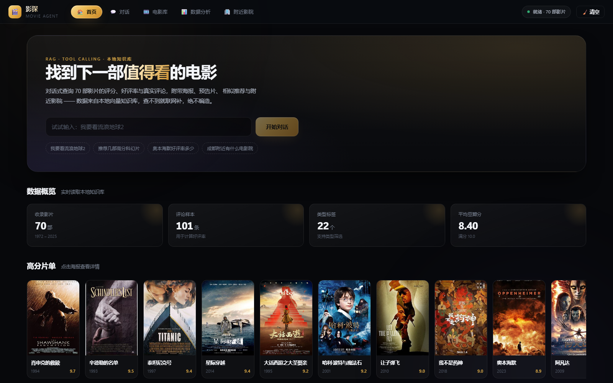
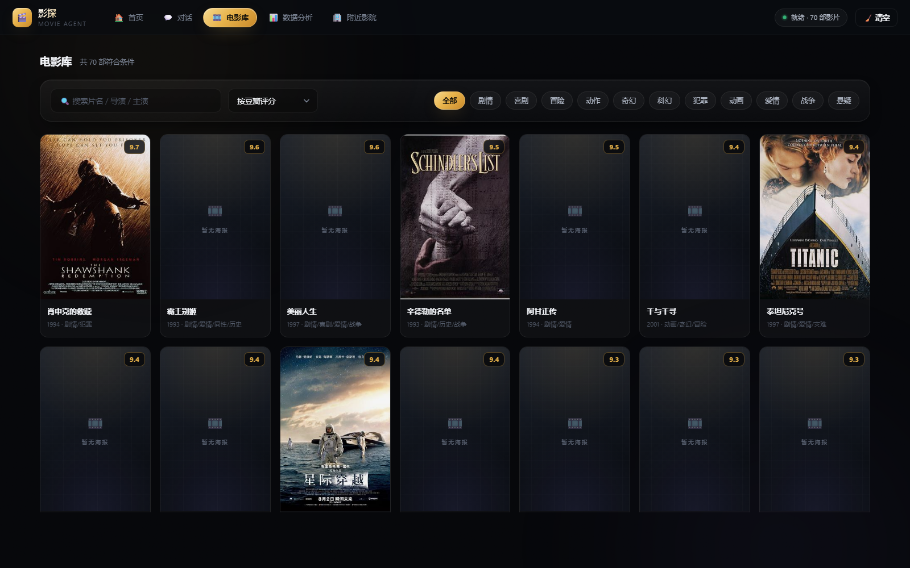
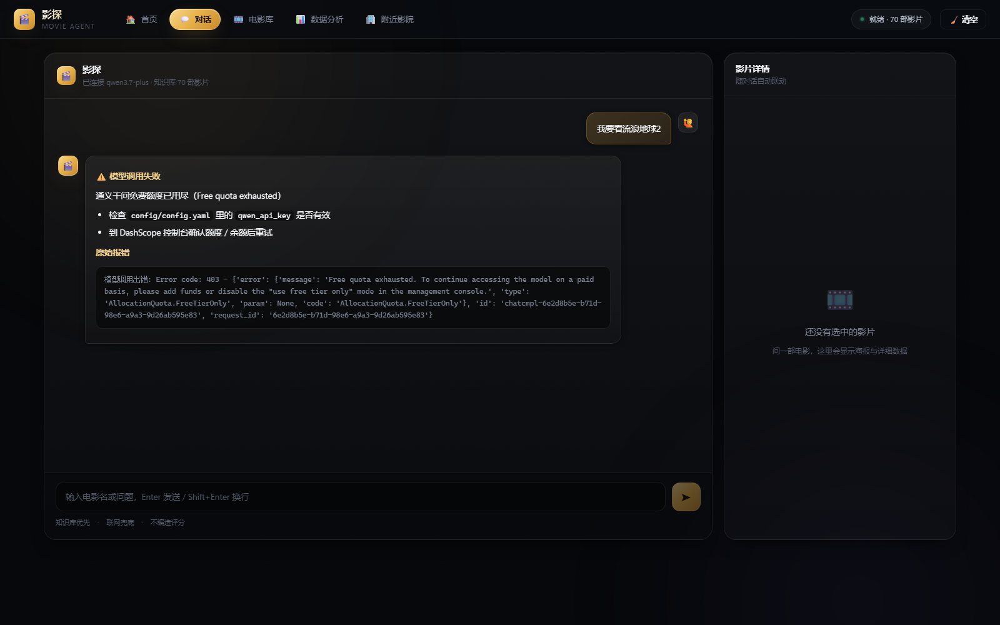
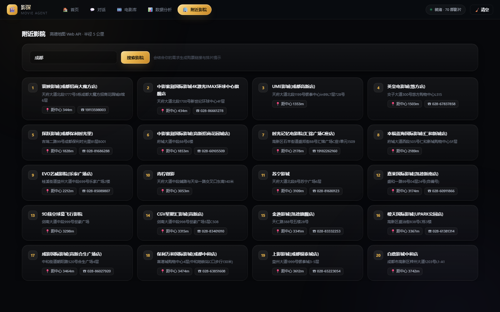

# 🎬 电影查询智能体 v2.0

基于 **LangChain + 通义千问 API + FAISS 向量库** 构建的本地电影智能助手，界面为 **Vue 3 网页端**。

用户输入"我要看 XX 电影"，自动返回：
- 电影基础信息（导演、主演、类型、简介）
- 评分 & 好评率（豆瓣/猫眼/IMDb）
- 精选好评/差评
- 电影海报
- 预告片
- 相似电影推荐
- 附近影院
- 对话回复逐字流式输出

---

## ✨ 界面预览

**首页** — 极光氛围背景、数据概览、高分片单海报墙


**电影库** — 搜索 / 类型筛选 / 排序，卡片悬停浮起并预览简介


**对话** — 聊天气泡 + 右侧影片详情联动（评分 / 好评率 / 精选评论 / 相似推荐）


**附近影院** — 高德地图 API 实时查询


> 网页端为纯本地运行：后端是 Python 标准库 `http.server` 写的 REST API，前端是 Vue 3 + 原生 ES Module，**Vue 运行时已随仓库提供，零 npm 依赖、零构建步骤**。

---

## ✅ 当前配置（本机已切换完成）

> 这一节记录本机 **实际生效** 的配置，和下面「默认步骤」里的通义千问版本不同，照这一节做即可。

| 项目 | 实际使用 | 说明 |
|---|---|---|
| 对话模型 | **DeepSeek `deepseek-flash`** | `model.provider: "deepseek"`，Key 填在 `config.yaml` 的 `deepseek_api_key`，也可用环境变量 `DEEPSEEK_API_KEY` |
| 思考模式 | **关闭** | `deepseek_thinking: false`。实测该开关生效：关闭后不产生 reasoning，多轮工具调用更快更省 token |
| 向量化 | **本地 `BAAI/bge-small-zh-v1.5`** | `embedding.provider: "bge"`，512 维，不再依赖通义 Key，也不消耗任何额度 |
| 模型缓存位置 | **项目内 `models_cache\`** | 由 `src/utils.py` 的 `setup_model_cache()` 锁定（`HF_HOME`/`SENTENCE_TRANSFORMERS_HOME`/`TORCH_HOME`），不再散落到 `C:\Users\<用户>\.cache` |
| 下载源 | `https://hf-mirror.com` | 国内直连 huggingface.co 会超时；有梯子可自行覆盖 `HF_ENDPOINT` |
| Python | **3.12**（`%LOCALAPPDATA%\Programs\Python\Python312`） | 不能用 3.15：`faiss-cpu` 最高支持 3.14，`zstandard` 在 3.15 没有预编译包 |

**换回通义千问**：把 `model.provider` 改成 `"qwen"` 并确保 `qwen_api_key` 有效；**换回在线向量化**：把 `embedding.provider` 改成 `"qwen"`、`model_name` 改回 `"text-embedding-v3"`，然后必须重建向量库（维度不同）：
```
.venv\Scripts\python.exe main.py --build-kb
```

---

## 🌐 联网能力（本地优先 · 联网兜底）

知识库只有 70 部影片（1972–2025），遇到库里没有的新片/冷门片，Agent 会**实时爬取豆瓣**补齐。

**策略是严格"本地优先"**，由两个工具实现（`src/agent_tools.py`）：

| 工具 | 作用 | 何时调用 |
|---|---|---|
| `list_movies` | 按 `year` / `genre` / `min_rating` 从**本地** CSV 筛片单 | 「2025年有哪些电影」「有什么科幻片」「8分以上的」这类**不针对某一部片**的提问 |
| `search_movie_web` | **先查本地知识库**，命中就直接返回；没命中才联网抓豆瓣 | 用户报了具体片名，或本地查不到该片时 |

实测日志（本地命中时**零联网**）：
```
search_movie_info('流浪地球2') → 本地命中 → 全程无网络请求 ✅
search_movie_info('沙丘3')    → 本地没有 → search_movie_web → 抓回豆瓣实时数据 ✅
list_movies({'year':'2025'})  → 命中 6 部（本地）✅
list_movies({'year':'2026'})  → 本地无 → 如实告知收录范围，不编造 ✅
```

**联网数据源实测（`src/movie_online.py`）**：

| 数据源 | 结果 |
|---|---|
| `movie.douban.com/j/subject_suggest` | ✅ 可用：片名 / 年份 / 海报 / 豆瓣 ID |
| `m.douban.com/movie/subject/<id>/`（**必须手机 UA**） | ✅ 可用：评分 / 评价数 / 类型 / 地区 / 片长 / 上映 / 简介 / 海报 |
| `movie.douban.com/subject/<id>/`（桌面详情页） | ❌ 反爬，302 到 `sec.douban.com` |
| TMDB / 猫眼 / 百度百科 | ❌ 网络不通或 403（猫眼 AI 抓取被封） |

**已知限制（务必了解）**：
1. **豆瓣会限流**：短时间连续查询会返回**空数组**（HTTP 200），表现为「查不到」。代码已做三层保护——内存缓存 + 请求间隔（默认 3 秒，取自 `crawler.request_delay`）+ 限流重试（间隔 6s/18s）。仍被限流时会**如实告诉用户**，绝不编造。
2. **联网抓不到导演和主演**：豆瓣手机站不展示演职员表，所以联网结果里没有这两项（本地库有）。
3. **联网海报直接给豆瓣图片 URL**，不落到 `data/posters/`，因此右侧「影片详情」面板可能显示「本地暂无海报」——这是正常的，聊天回复里会给出图片链接。
4. **联网只用于"查一部片"**，不支持"按年份列出豆瓣全部新片"（豆瓣没有这种公开接口）。

---

## 🚀 使用步骤

> 📖 **第一次跑这个项目？** 直接看 **[运行说明书.md](运行说明书.md)** ——
> 里面有 Windows / macOS / Linux 三种系统的完整步骤、按报错信息查的常见问题表、
> 以及绿色版（免安装压缩包）的用法。下面是精简版。

### 1. 准备 Python 3.12 并建虚拟环境
> ⚠️ **必须用 Python 3.12（3.13/3.14 也可）**，不要用 3.15：`faiss-cpu` 只支持到 3.14，
> `zstandard` 在 3.15 没有预编译包，pip 会转去源码编译并因缺少 MSVC 而失败。
> 仓库根目录的 `.python-version` 已标注版本，pyenv / uv 会自动识别。

```
python -m venv .venv
.venv\Scripts\python.exe -m pip install -r requirements.txt -i https://pypi.tuna.tsinghua.edu.cn/simple
```

安装含 CPU 版 PyTorch（约 120MB 轮子），总共约 1.5GB。依赖装完会在项目内生成 `.venv\`。

### 2. 配置 API Key ⚠️ 必做
仓库里只有配置模板（含真实密钥的 `config.yaml` 已被 `.gitignore` 忽略），先复制一份：
```
copy config\config.example.yaml config\config.yaml
```
然后打开 `config/config.yaml` 填 Key。**填哪一个取决于 `model.provider`**：

| provider | 要填的字段 | 申请地址 |
|---|---|---|
| `deepseek`（推荐） | `deepseek_api_key` | https://platform.deepseek.com/api_keys |
| `qwen` | `qwen_api_key` | https://dashscope.console.aliyun.com/ |

也可以用环境变量，不必改文件：`DEEPSEEK_API_KEY` / `DASHSCOPE_API_KEY`（对话与向量化）、`AMAP_API_KEY`（附近影院）。

**向量化怎么选**（`embedding.provider`）：
- `bge`（默认）：本地模型 `BAAI/bge-small-zh-v1.5`，**不需要任何 Key**，首次运行会从 hf-mirror.com 下载约 92MB 到项目内 `models_cache\`；
- `qwen`：在线 `text-embedding-v3`，需要一个有效的 DashScope Key（DeepSeek 不提供 Embedding 接口）。

> ⚠️ `config.yaml` 已进 `.gitignore`，**请勿把它提交到仓库**。附近影院功能再另填 `amap.api_key`。

### 3. 启动
```
.venv\Scripts\python.exe main.py
```
或双击 `start_web.bat`（Windows，会自动打开浏览器）。

> ⚠️ 不要直接用 `python main.py`——若系统默认 python 不是 3.12，会因缺依赖报 `ModuleNotFoundError: No module named 'yaml'`。

浏览器访问 http://127.0.0.1:8765 即可。启动分两段：HTTP 服务**立刻**可用，模型与知识库在后台线程加载（约 30–40 秒），期间 `/api/status` 的 `ready` 为 false。

首次运行会自动构建向量知识库（用本地 bge 向量化 70 部影片，约十几秒）。

### 4. 使用
在输入框输入"我要看流浪地球2"即可查询；也可以问"2025年有哪些电影""有什么科幻片"（走 `list_movies`）。
库里没有的新片会被自动联网爬取（见上文「联网能力」一节）。

---

## 🔀 切换模型

LLM 与 Embedding 是**分开配置**的，改 `config/config.yaml` 即可，代码不用动。

| 供应商 | `model.provider` | 说明 |
|---|---|---|
| **DeepSeek** | `deepseek` | 模型 `deepseek-flash` / `deepseek-v4-pro`，均支持 Function Calling |
| 通义千问 | `qwen`（默认） | 额外支持模型侧联网搜索（`enable_search`） |
| OpenAI | `openai` | 任意 OpenAI 兼容端点，可用 `openai_base_url` 指向自建网关 |
| Ollama | `ollama` | 本地模型，需额外安装 `langchain-ollama` |

**换成 DeepSeek 只要两步**（申请 Key：https://platform.deepseek.com/api_keys）：

1. 填 Key（也可以设环境变量 `DEEPSEEK_API_KEY`）：
   ```yaml
   deepseek_api_key: "sk-你的Key"
   ```
2. 把 provider 改一行：
   ```yaml
   provider: "deepseek"
   ```

> ⚠️ **Embedding 换不了 DeepSeek**：DeepSeek 不提供 Embedding 接口，向量化仍走通义的
> `text-embedding-v3`（`embedding.provider: qwen`），所以要保留一个 DashScope Key。
> 想彻底脱离通义，可把 `embedding.provider` 改成 `bge` 用本地模型（需装 `sentence-transformers` 并重建向量库）。
>
> 不过**已有 `data/vector_db/` 时运行期不会发起向量化请求**，所以 DashScope 额度用尽也不影响对话功能。

**关于 DeepSeek 思考模式**：本项目默认设为关闭（`deepseek_thinking: false`）。原因是本项目的 Agent 是"多轮工具调用"场景，关闭思考模式响应更快、更省 token；需要深度推理时改为 `true` 即可。另注意思考模式下 `temperature` 参数不生效。

---

## 📁 项目结构
```
movie-agent/
├── main.py                    # 主入口（网页版 / 数据管道 CLI）
├── start_web.bat              # Windows 一键启动
├── requirements.txt           # 依赖清单
├── config/
│   ├── config.example.yaml    # 配置模板（复制为 config.yaml 后填 Key）
│   └── config.yaml            # 本地配置（含密钥，已被 .gitignore 忽略）
├── prompts/system_prompt.yaml # 提示词工程
├── src/                       # 业务核心
│   ├── utils.py               # 工具函数（配置加载、日志、目录初始化）
│   ├── model_loader.py        # LLM / Embedding 适配层
│   ├── data_cleaner.py        # 数据清洗
│   ├── knowledge_base.py      # FAISS 知识库与检索
│   ├── crawler.py             # 海报与影片信息抓取
│   ├── analyzer.py            # 关联分析与可视化（仅命令行 --analyze，不接入网页）
│   ├── cinema.py              # 附近影院（高德 API）
│   └── agent.py               # 智能体（工具调用）
├── server/app.py              # 后端：标准库 HTTP API
├── web/                       # 前端：Vue 3（无需构建）
│   ├── index.html
│   ├── app.js
│   ├── styles.css
│   └── vendor/vue.global.prod.js
├── data/
│   ├── raw/                   # 原始数据（放你的 CSV/Excel）
│   ├── cleaned/               # 清洗后数据
│   ├── posters/               # 海报（抓取缓存）
│   └── vector_db/             # FAISS 向量库
├── docs/screenshots/          # 界面截图
└── output/analysis/           # 分析图表
```

---

## ⚡ 对话流式输出

对话默认走 `POST /api/chat/stream`（Server-Sent Events），回复**逐字显示**而不是等全部生成完。

事件格式（每条一行 `data: {...}`）：

| type | 含义 | 前端动作 |
|---|---|---|
| `token` | 正文增量 | 追加到当前气泡 |
| `tool` | 正在调用哪些工具 | 显示「正在查询：xxx」，并清空铺垫文字 |
| `meta` | 海报 / 预告片 / 影片名 | 挂上海报卡片、联动右侧面板 |
| `done` | 结束 | 停止光标闪动 |
| `error` | 出错 | 显示提示 |

实现要点：模型在调用工具前常说的「我来帮你查一下…」不会被推送出去
（否则工具跑完正文重来会出现重复内容）；只有确定是最终答案的那一轮才逐块下发。
后端不支持流式时，前端会自动回退到 `POST /api/chat` 一次性拿完整答案。

---

## 🌐 接口一览

全部返回 JSON，CORS 已开放。

| 方法 | 路径 | 说明 |
|------|------|------|
| GET | `/api/status` | 模型与知识库初始化状态 |
| GET | `/api/movies?q=&genre=&sort=&limit=` | 电影列表（含好评率、海报 URL） |
| GET | `/api/movie?title=` | 影片详情 + 精选评论 + 相似推荐 |
| POST | `/api/chat` | 对话，一次性返回（`{"message": "..."}`） |
| POST | `/api/chat/stream` | **流式对话**，SSE 逐字推送（前端默认走这个） |
| POST | `/api/chat/reset` | 清空多轮对话历史 |
| GET | `/api/cinemas?city=` | 附近影院（高德地图） |
| GET | `/api/poster?title=` | 海报图片 |

前端支持深链接：`http://127.0.0.1:8765/?ask=我要看流浪地球2` 会自动发起提问，`#library` / `#cinema` 等可直接定位页面。

**为什么不用 Vite / npm？** 网页端刻意做成零构建：Vue 3 运行时随仓库提供，静态资源由同一个 Python 进程托管，用户克隆后 `pip install -r requirements.txt` 即可运行，不需要 Node 环境。

---

## 💡 导入自己的数据

1. 准备 CSV/Excel，列名支持中英文：电影名/title、导演/director、主演/actors、类型/genre、年份/year、豆瓣评分/douban_rating、猫眼评分/maoyan_rating、简介/summary
2. 放入 `data/raw/`
3. 重建知识库生效：
```
python main.py --clean      # 清洗数据
python main.py --build-kb   # 重建向量库
```

## 🔧 命令行模式
```
python main.py               # 启动网页版（默认）
python main.py --clean       # 清洗数据
python main.py --analyze     # 关联分析（只生成箱线图到 output/analysis/，网页已移除该页）
python main.py --build-kb    # 重建知识库
python main.py --chat        # 命令行聊天
```

## 📦 技术栈

Python 3.12 · LangChain（core / community / text-splitters）· **DeepSeek / 通义千问 qwen-plus（OpenAI 兼容接口 + Function Calling）** · text-embedding-v3 · FAISS · Vue 3（Composition API，原生 ES Module）· Python 标准库 `http.server` · pandas / numpy · matplotlib / seaborn · 高德地图 Web API · TMDB / 豆瓣公开接口
